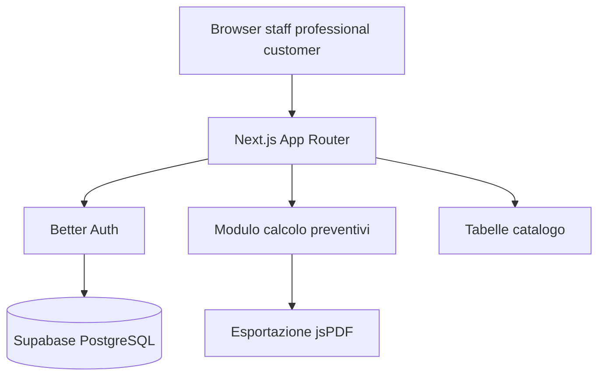

# Architettura

## Percorsi principali

- `/login`: accesso autenticato.
- `/`: dashboard e preventivi recenti, filtrati per ruolo.
- `/quotes/new`: procedura guidata per creare un preventivo.
- `/admin`: amministrazione riservata allo staff.
- `/admin/users`: creazione di professional/customer e collegamento dei clienti.
- `/api/auth/[...all]`: endpoint Better Auth.

## Persistenza

Drizzle definisce organizzazioni, utenti, sessioni, account, catalogo, clienti
e preventivi in [lib/db/schema.ts](../lib/db/schema.ts). I preventivi salvano
input, righe BOM e totali per poterli ricostruire.

I dati operativi includono `organizationId`. Il catalogo può essere globale
(organizzazione nulla) oppure specifico di un'organizzazione. Il comando
`npm run seed:organization` crea `org-default` e associa i dati esistenti.

## Calcolo

[lib/quote/calculate.ts](../lib/quote/calculate.ts) è la fonte condivisa per
volume, portata, materiali, manodopera, margine e IVA. Il PDF viene generato
da [lib/quote/pdf.ts](../lib/quote/pdf.ts).

## Sicurezza

Il middleware protegge i percorsi dell'applicazione e le server action usano un
contesto centralizzato con utente, ruolo e organizzazione. Staff ha accesso
globale; professional è limitato alla propria organizzazione; customer può
leggere solo i preventivi collegati ai propri clienti e non può modificarli.
