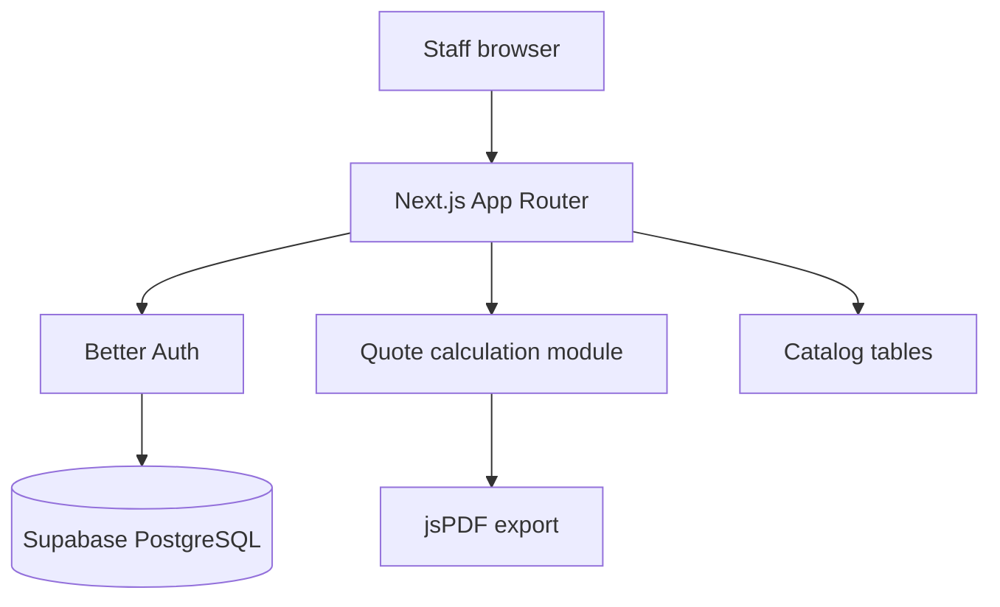

# Arquitectura

## Rutas principales

- `/login`: acceso staff.
- `/`: dashboard y presupuestos recientes.
- `/quotes/new`: wizard de creación.
- `/api/auth/[...all]`: endpoints Better Auth.

## Persistencia

Drizzle define usuarios, sesiones, cuentas, catálogo, clientes y presupuestos
en [lib/db/schema.ts](../lib/db/schema.ts). Los presupuestos guardan inputs,
líneas BOM y totales para poder reconstruirlos.

## Cálculo

[lib/quote/calculate.ts](../lib/quote/calculate.ts) es la fuente compartida de
volumen, caudal, materiales, mano de obra, margen e IVA. El PDF se genera en
[lib/quote/pdf.ts](../lib/quote/pdf.ts).

## Seguridad

El middleware protege las rutas de aplicación y `requireStaff()` valida el rol
en las server actions. El rol `customer` queda reservado para una futura vista
de solo lectura.
