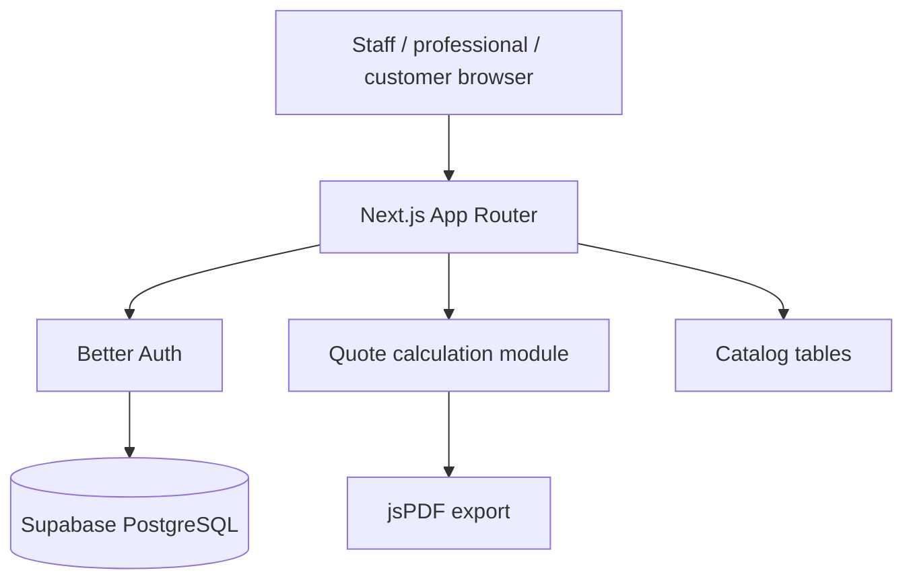

# Arquitectura

## Rutas principales

- `/login`: acceso autenticado.
- `/`: dashboard y presupuestos recientes, filtrados por rol.
- `/quotes/new`: wizard de creación.
- `/admin`: administración exclusiva de staff.
- `/admin/users`: creación de professional/customer y vinculación de clientes.
- `/api/auth/[...all]`: endpoints Better Auth.

## Persistencia

Drizzle define organizaciones, usuarios, sesiones, cuentas, catálogo, clientes y presupuestos
en [lib/db/schema.ts](../lib/db/schema.ts). Los presupuestos guardan inputs,
líneas BOM y totales para poder reconstruirlos.

Los registros operativos incluyen `organizationId`. El catálogo puede ser global
(organización nula) o específico de una organización. `npm run seed:organization`
crea `org-default` y asocia los datos de una instalación anterior.

## Cálculo

[lib/quote/calculate.ts](../lib/quote/calculate.ts) es la fuente compartida de
volumen, caudal, materiales, mano de obra, margen e IVA. El PDF se genera en
[lib/quote/pdf.ts](../lib/quote/pdf.ts).

## Seguridad

El middleware protege las rutas de aplicación y las server actions usan un contexto
centralizado de usuario, rol y organización. Staff tiene acceso global; professional
queda limitado a su organización; customer solo puede leer presupuestos vinculados
a sus clientes y nunca puede guardarlos o editarlos.
